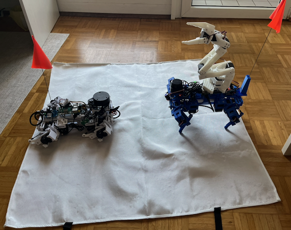

# Tag of Flag (機甲奪旗賽)

Proposing Tag of Flag as a game with quadrupeds carrying an arm. The goal is to capture the flag on the back of the opponent's quadruped.

With the recent CD-07B update ([GitHub](https://github.com/SphericalCowww/CubicDoggo_07B)) suggesting a low-budget 12-DOF quadruped can carry more than 1 kg of payload, and a recent ROS2 Jazzy implementation ([GitHub](https://github.com/adoodevv/so101_ros2)) of the SO-101 arm of roughly 700g ([HuggingFace](https://huggingface.co/docs/lerobot/en/so101)), I think this make the following game challenge possible. 

In developing the winning strategies, this game could enforce multiple engineering disciplines that are beneficial to the robotics community. I believe this game has the potential to be **a long-term educational and research platform and a worthwhile benchmark** to aim for. Here is a link to the [subreddit](https://www.reddit.com/r/TagofFlag/) that was created.

The following are suggested rules to have as a starting point.

## V0 Rules

### Goal

The goal is simple: 2 players each control a quadruped that starts with a flag on its back. The player wins when the opponent's flag leaves the flag-mount in any way or when the opponent exits the arena

### Safety

   * **Fire safety**: Please bring a bucket of sand and a long barbecue tong in case the lithium batteries catch on fire. Preferably with a fire blanket as well; drag the robot on the blanket with the tong if needed
   * Disabling servo stall shutdown is NOT allowed

### Arena/flag

  * Arena: a 2 m x 1 m treadmill mat (for example, [Amazon](https://www.amazon.de/-/en/gp/product/B0GFDWTKKX)). The robot exits the arena if one foot lands outside the arena
  * Start position: long opposite ends of the arena facing each other
  * Height baseline: the top of the battery pack
  * Rest stance: the default robot stance when the robot is just turned on without touching the controllers
  * Flag standard: a 38 cm tall survey flag, with a pole diameter of 1.5 mm (for example, [Amazon](https://www.amazon.de/Assembly-writeable-landscaping-weatherproof-measuring/dp/B0BGSCJXCQ))
  * Flag-mount standard: any shape as long as it has a clearance that is 4 cm tall with a >= 6 mm diameter. The bottom of the clearance must be within 8 cm in height of the height baseline. The clearance must point straight upward in the rest stance
  * Please bring spare flag-mounts. Don't want broken flag-mounts for disqualification

### Robot requirements

  * 4x``N``-DOF quadruped with an ``M``-DOF arm using ST-3215 servos (including the servo horns). The ``N`` and ``M`` can be any numbers, but with the budget controlled to < 1000 EUR. See the "Budget calculation" section for details
  * Printed with PLA or its variants for all its support parts, but otherwise free to design any parts 
    - Bolts+nuts+washers, heat set inserts, and glue are all allowed, but only for connections
    - Also allow bearings and the linkages/spacers between bearings to be non-PLA materials, but again only for connections
    - Allow gripping material only on the feet
    - Considering the shielding dimension, the CAD should not be built to be taller than the mounted flag-mount on the robot; no part should be covering or overlapping with the line of sight of the flat insert. The only exception will be the moving parts of the arm
    - No hook or sharp structure on the arm 
  * Controlled by ROS2, but the gait, automation, and reinforcement learning stack are completely free to optimize
  * Sensors such as IMU, camera, and LIDAR are all allowed up to the budget, but watch out for potential damages
  * Untethered using batteries
  * The electronic boards must be covered by PLA protection at least from the top
  * No wheels by default
  * No projectiles
  * Let's avoid custom PCBs as the budget is difficult to judge

#### Controller requirements

  * The budget for the controller is unlimited, but see what is allowed in the "Budget calculation" section
  * The controllers should be remote
  * During the game, the human operators should stand at least 1 m away from the arena
  * Please don't let the controller run out of power

#### Recommendations

  * Standard ``N = 3`` and ``M = 6``, or a 12-DOF quadruped with a 6-DOF arm such as the SO-101 follower
  * Raspberry Pi 5 running Ubuntu 24.04 and ROS 2 Jazzy as the reference platform
  * The robots are meant to be controlled by one or two human operators with a remote controller and an SO-101 leader arm. However, complete automation is also welcome
  * The rubber on the feet is really not necessary given the grip on the arena

#### Dimension reference

  * ([CD-07B](https://github.com/SphericalCowww/CubicDoggo_07B)) is around 30 cm wide and 40 cm long, with the baseline height at 5.5 cm in rest stance and at 14 cm in standing stance

### Game rules

  * The following are NOT allowed in deliberate damage to the opponent's robot:
    - No tripping/bending/twisting on the legs
    - No poking/smashing on the electronic boards/battery protections
    - No poking/smashing on the sensors
    - No pulling on the wires (must force pause when accidentally tangled)
    - ... to be exhausted
    - Accidental actions will be warned. Deliberate and repeated accidental actions will result in disqualification
  * The body-to-body contact is permitted. The arm-to-body contact is only allowed on the PLA parts. The arm-to-leg contact is prohibited
  * Recommended start sequence of each side stands up and rests one after another, then stands up and rests together to check controller interference
    - No interference with the communication, control, or software systems, including hacking or jamming
    - No interference with the human controllers in any way
  * Each game times out after 10 min:
    - If the servo stalls or the PLA parts break (flag-mount included) during this time, the human controller cannot intervene until the game ends. Early resignation call is possible
    - If the sensors break, can call to pause the game to judge whether to continue or not
    - If the wire falls off, can call to pause the game to reconnect the wires
    - If the controllers lose control, can call to pause the game to judge whether to continue or not
    - The pause can be resumed by going back to the starting position without restarting the timer
    - If both sides agree, like if both sides have PLA parts break and servos stall, the game can be called to reset before 10 min, including resetting the timer
    - If after 10 min and no side wins, the game resets. Can restart robot and/or fix broken PLA parts in between
    - A best of 5 as standard. During the full duration of these games, the battery cannot be recharged. For extended draws, the side whose battery runs out first, such that the controller communication is lost, loses

### Potential tactics

  * Use PLA shielding to protect the flag surround
  * Control better manually to bypass the opponent's arm, made possible if the gait is nicely written
  * Use Nav to circle around the opponent
  * Use RL to compensate for the arm extension imbalance

Depending on the actual performance when improved to the ST3215's limits, the game probably resembles less of a dogfight, but a naval duel that some type of anchor-mode (rest stance) is needed to maximally extend the arm. The latter can still create interesting dynamics given that transitioning between rest and standing stance is fast, and the rest stance suffers from lowering the flag mount height significantly

  * Note that no rule says the belly cannot contact the ground
  * Even if the leg is broken, the player is still in the game if the flag is still safe

### Budget calculation

The PLA parts, wires and soldering materials, bolts+nuts+washers, heat set inserts, glue, bearings, bearing-linkages/-spacers, and gripping material on the feet are not accounted for in the budget. The remaining items are listed below using the euro as a reference, but standardized so they are not influenced by the actual price. The maximum budget is 1000 points.

| Devices | Assigned Points | Reference Links | Comments |
| - | - | - | - |
| ST-3215 servos | 25 | | No matter the version |
| Serial bus servo driver board | 5 |  |  |
| Raspberry Pi | 150 |  |  |
| USB hub | 10 |  |  |
| Votage converters | 10 |  |  |
| Lithium battery/power bank | 20 |  |  |
| other controller boards | - | - | TBD |
| various sensors | - | - | TBD |

So for CD-70B + SO-101 follower, it's ``(12*25 + 2*5) + (6*25 + 5) + 150 + 10 + 10 + 2*20 = 675``. Still much room to reach 1000 for the sensors

#### Controller 

There is no budget limit for controllers, but only the following are allowed for controllers,

  * Tables and seats, placed at least 1 m away from the arena
  * Any power sources, be it batteries, power banks, or just plugging into the wall
  * A SO-101 leader arm, or one any other teleoperating arms
  * A Raspberry Pi
  * Custom handheld controllers (for Bluetooth, watch out for interference)
  * A remote gaming controller
  * A keyboard
  * A mouse
  * A laptop
  * A monitor, but bring one that can be easily carried
  * No desktops are allowed

## V0 team game extension prospect

  * A team of 4. As an exception, each team can potentially host a single ace unit that is allowed to have wheels
    - Ace must be a 4x4 DOF quadruped with the same required ST3215 servos. Yes, the wheels also have to use ST3215 to not give it too much of an advantage and also not just a cart robot
    - Arena size limited to balance the ace, perhaps two 2 m x 1 m treadmill mats combined (for example, [Amazon](https://www.amazon.de/-/en/gp/product/B0GFDWTKKX))
    - Free of initial positioning on your side of the arena. Sequential placement with a coin flip to decide who goes first, and the ace is placed first
    - Each robot carries a flag, and the robot with its flag taken continues to be active on the field, but the robot exiting the arena is eliminated
    - Up to 10 min game; the game ends with one team losing all flags. The team with the most flags left wins
    - Can be played under different terrains
  * Perhaps allow multi-robot coordination codes
  * Perhaps allow CAD linkage between robots

## References:

- CubicDoggo 07B: Homemade 12-DOF 4-Legged Robot Recipe ([GitHub](https://github.com/SphericalCowww/CubicDoggo_07B))
- adoodevv, so101_ros2 ([GitHub](https://github.com/adoodevv/so101_ros2))
- LeRobot, SO-101 ([HuggingFace](https://huggingface.co/docs/lerobot/en/so101))

